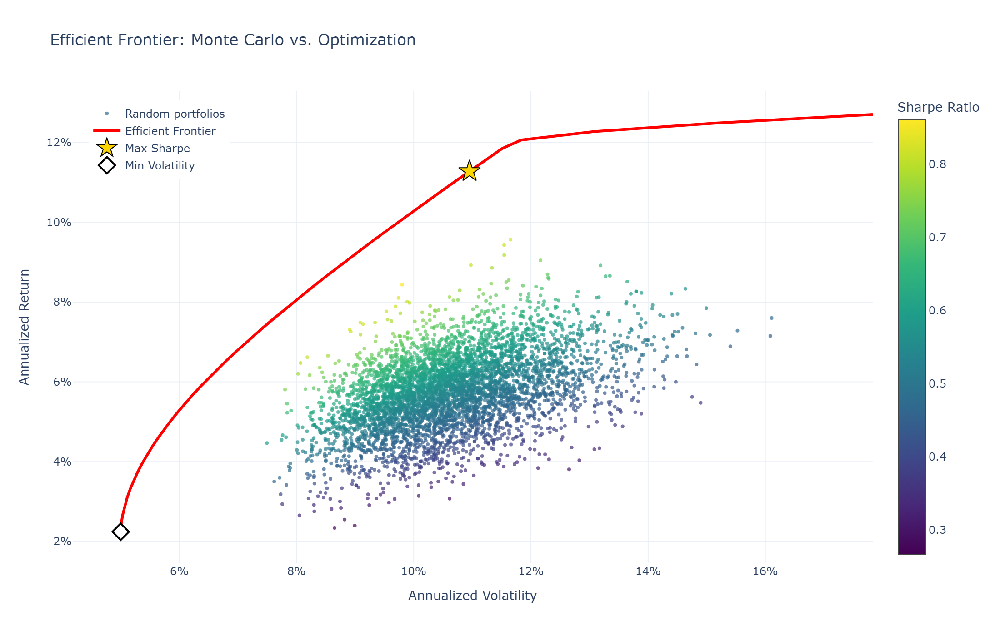

# Markowitz Portfolio Optimizer

Mean-variance portfolio optimization on a multi-asset ETF universe, built in Python.
The project compares a Monte Carlo simulation of random portfolios against the exact
solution obtained with constrained optimization (`scipy.optimize`), and visualizes
the efficient frontier interactively with Plotly.



## Theory

### Log returns

Daily log returns are computed from adjusted closing prices:

$$r_t = \ln\left(\frac{P_t}{P_{t-1}}\right)$$

Log returns are additive over time, which makes annualization straightforward.
The portfolio return is approximated as a weighted sum of asset log returns,
an approximation that is negligible at daily frequency.

### Annualized estimators

With 252 trading days per year:

$$\mu = 252 \cdot \bar{r}_{\text{daily}}, \qquad \Sigma = 252 \cdot \text{Cov}(r_{\text{daily}})$$

### Portfolio return, risk and Sharpe ratio

For a weight vector $w$ with $\sum_i w_i = 1$:

$$\mu_p = w^\top \mu, \qquad \sigma_p = \sqrt{w^\top \Sigma w}, \qquad
\text{Sharpe} = \frac{\mu_p - r_f}{\sigma_p}$$

### Optimization problem

The maximum Sharpe portfolio solves

$$\max_{w} \; \frac{w^\top \mu - r_f}{\sqrt{w^\top \Sigma w}}
\quad \text{s.t.} \quad \sum_i w_i = 1, \;\; w_i \ge 0$$

and the efficient frontier is obtained by minimizing $\sigma_p$ for each target return.
Since `scipy.optimize.minimize` only minimizes, the negative Sharpe ratio is used as objective (SLSQP method).

## Project Structure

```
mpt-optimizer/
├── src/
│   ├── data.py          # download, cleaning, log returns
│   ├── simulation.py    # Monte Carlo portfolio simulation
│   └── optimization.py  # max Sharpe, min volatility, efficient frontier
├── results/             # interactive HTML and static PNG of the frontier
├── 01_datos.ipynb       # analysis notebook
├── requirements.txt
└── README.md
```

## Installation and Usage

```bash
git clone https://github.com/pablo-sanchez-delbosque/mpt-optimizer.git
cd mpt-optimizer
pip install -r requirements.txt
jupyter notebook
```

Open the notebook and run all cells (Kernel → Restart & Run All).

Asset universe: SPY, EFA, EEM, AGG, TLT, GLD, VNQ, DBC (2015-2025, Yahoo Finance).

## Results

| Portfolio | Return | Volatility | Sharpe (rf = 0) |
|---|---|---|---|
| Minimum volatility | 2.24% | 5.00% | 0.45 |
| Equal weights | 5.76% | 10.32% | 0.56 |
| Best of 10,000 Monte Carlo | 9.01% | 9.67% | 0.93 |
| **Maximum Sharpe (SLSQP)** | **11.28%** | **10.95%** | **1.03** |

The optimal portfolio allocates roughly 53% to GLD, 40% to SPY and 7% to AGG.
Random sampling rarely reaches the frontier because it almost never produces
concentrated portfolios with exact zero weights.

## Limitations

- **In-sample:** weights are optimized and evaluated on the same period, so results are optimistic. An out-of-sample backtest is needed.
- **Estimation error:** mean-variance optimization is highly sensitive to the expected returns estimated from history (here, GLD's strong performance drives the allocation).
- **Non-stationary correlations:** e.g. the negative stock-bond correlation broke down in 2022.
- **Normality assumption:** real returns have fat tails.
- **No transaction costs, taxes or rebalancing; long-only, no leverage.**
- Free Yahoo Finance data.